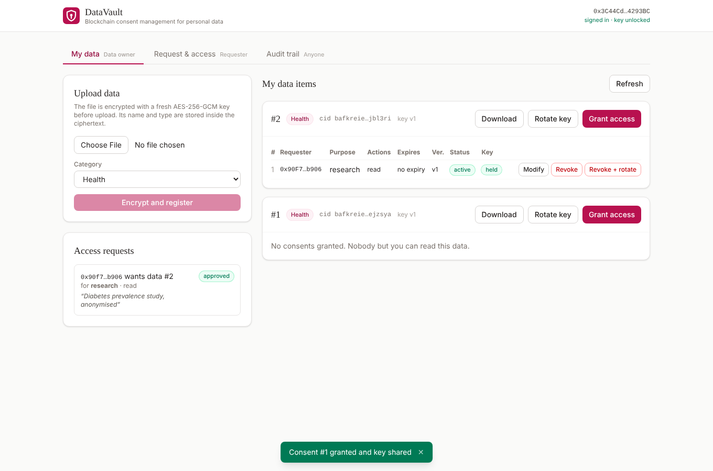
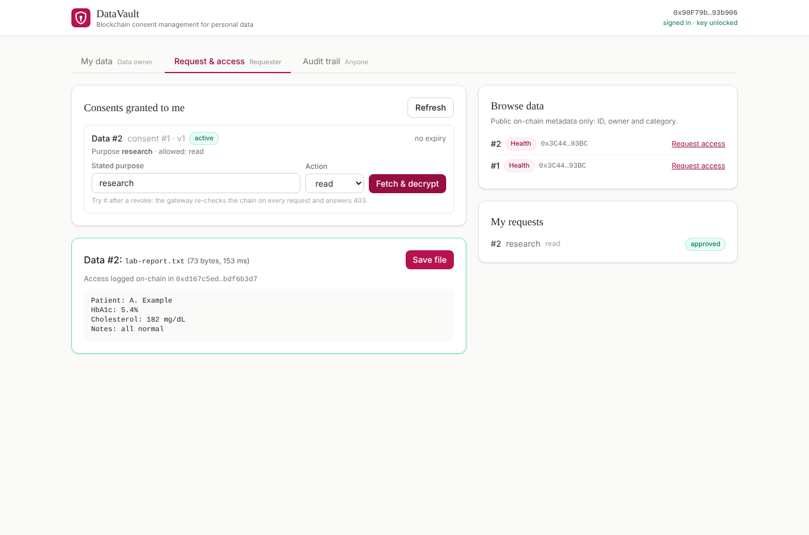
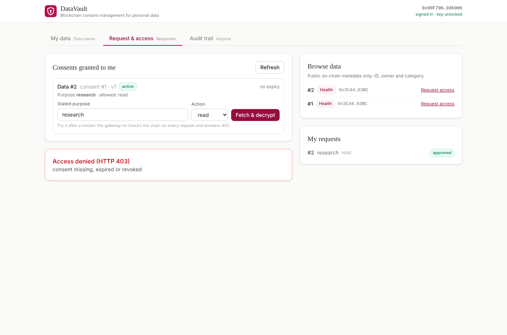
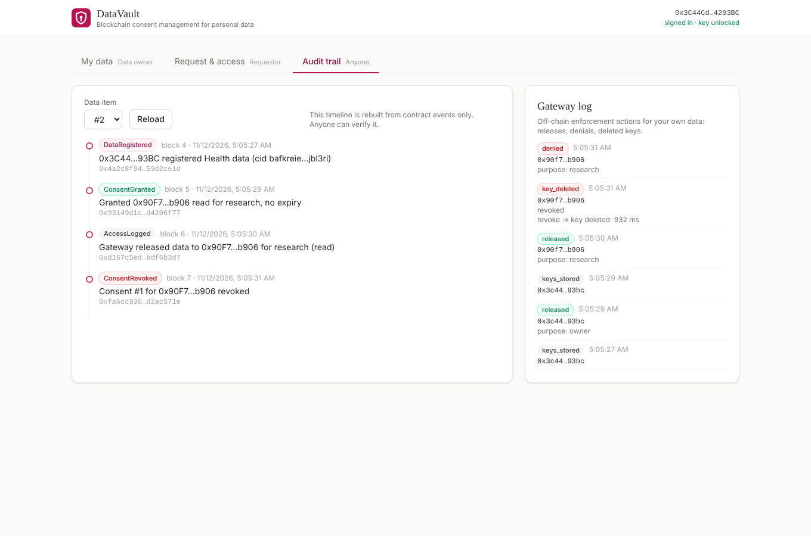

# DataVault

**Blockchain-based consent management for personal data sharing.**

DataVault lets people decide who may use their personal data, for what purpose and until when, and lets them **grant, modify and revoke** that permission themselves with smart contracts. Every consent change is recorded on Ethereum, so nobody can quietly edit the consent history. The personal data itself never touches the blockchain. It is encrypted in the owner's browser, stored in IPFS as ciphertext, and released only through an **Access Gateway** that checks the smart contract on every single request. When consent is revoked, the gateway refuses the next request, deletes the requester's key, and the owner can re-encrypt the file so that even a previously copied key becomes useless.



---

## Contents

1. [The problem and what DataVault does](#1-the-problem-and-what-datavault-does)
2. [Architecture](#2-architecture)
3. [Project layout](#3-project-layout)
4. [Quick start: run the full demo locally](#4-quick-start-run-the-full-demo-locally)
5. [Demo walkthrough](#5-demo-walkthrough)
6. [Command-line client](#6-command-line-client)
7. [Tests, gas report, coverage, benchmark and Slither](#7-tests-gas-report-coverage-benchmark-and-slither)
8. [Deploying to Sepolia](#8-deploying-to-sepolia)
9. [Using real IPFS](#9-using-real-ipfs)
10. [How it works in detail](#10-how-it-works-in-detail)
11. [Evaluation results](#11-evaluation-results)
12. [Security and privacy notes](#12-security-and-privacy-notes)
13. [Troubleshooting](#13-troubleshooting)
14. [Mapping to the project plan](#14-mapping-to-the-project-plan)

---

## 1. The problem and what DataVault does

Consent is the main lawful basis for processing personal data under the GDPR and India's DPDP Act 2023, but consent is usually kept in a database owned by the organisation that collects the data. Users cannot see how their consent is recorded, a log can be edited silently, and changing a consent normally means revoking it and starting over. Existing blockchain consent systems are mostly health-only, rarely support modifying a consent, and usually stop revocation at the chain without enforcing it where the data actually lives.

DataVault is built around three needs:

| Need | How DataVault meets it |
|------|------------------------|
| **Trust**: prove what a user agreed to, and when | Every grant, modify, revoke and access is an Ethereum event. The audit trail can be rebuilt from the chain alone. |
| **Control**: users grant, change and withdraw access themselves | The owner signs each change with MetaMask. Consents carry a purpose, an action set (read / share / process), an expiry and a version number. |
| **Enforcement**: revoked consent must actually block the data | All data goes through the Access Gateway, which calls `isAccessAllowed` on-chain for every request, deletes wrapped keys when consent is revoked, and supports *revoke and rotate* re-encryption. |

Objectives covered (from the project deck):

1. **Domain-neutral consent model**: every data item has a category (Health, Finance, Education, Location, Other) and every consent a purpose.
2. **Full consent life cycle**: `grantConsent`, `modifyConsent` (in place, version + 1) and `revokeConsent`, each with an event.
3. **Privacy by design**: AES-256-GCM encryption in the browser, ciphertext in IPFS, only hashes, IDs and permissions on-chain.
4. **Revocation that reaches the data**: per-request on-chain check, key deletion on `ConsentRevoked`, key rotation.
5. **Measured evaluation**: gas per operation, access-check latency, loop vs mapping, revoke-to-denial time (see [section 11](#11-evaluation-results)).

---

## 2. Architecture

```
   ┌──────────────────────┐                      ┌──────────────────────┐
   │  Data Owner          │                      │  Requester           │
   │  React + MetaMask    │                      │  React + MetaMask    │
   │  (encrypts in        │                      │  (decrypts in        │
   │   the browser)       │                      │   the browser)       │
   └───┬─────────────┬────┘                      └──────────┬───────────┘
       │ grant /     │ upload ciphertext,                   │ request data
       │ modify /    │ wrapped keys                         │ (signed-in, stated purpose)
       │ revoke      ▼                                      ▼
       │        ┌─────────────────────────────────────────────────────┐
       │        │  Access Gateway  (Node.js + Express + SQLite)        │
       │        │  • Sign-In with Ethereum (EIP-4361)                  │
       │        │  • isAccessAllowed?  ── on EVERY request ──────────┐ │
       │        │  • stores only ciphertext pointers + wrapped keys   │ │
       │        │  • listens for ConsentRevoked → deletes keys        │ │
       │        │  • logAccess → AccessLogged event                   │ │
       │        └───────────┬─────────────────────────────────────────┼─┘
       │                    │ fetch / pin ciphertext                  │
       ▼                    ▼                                         ▼
 ┌───────────────────────────────┐            ┌──────────────────────────────┐
 │  ConsentRegistry (Solidity)   │◄───────────│  IPFS                        │
 │  IDs, hashes, addresses,      │  CID +     │  AES-256-GCM encrypted files │
 │  permission flags, events     │  sha256    │  (Kubo node, Pinata or mock) │
 └───────────────────────────────┘            └──────────────────────────────┘
```

**Actors**

* **Data owner** uploads data and manages consent.
* **Requester** (a company, researcher or app) asks for data for a stated purpose.
* **Access Gateway** enforces the owner's decisions. It can withhold data but can never read it: it only ever sees ciphertext and keys wrapped for other people's public keys.

**Data flows**

| Step | What happens |
|------|--------------|
| Upload | Browser generates a random 256-bit key, encrypts the file with AES-256-GCM, gateway pins the ciphertext to IPFS, owner calls `registerData(cid, sha256, category)`, browser wraps the file key for the owner's own public key. |
| Grant | Owner picks requester, purpose, actions and expiry and signs `grantConsent`. The browser unwraps the file key and re-wraps it with ECIES for the requester's public key. |
| Modify | `modifyConsent` changes purpose, actions or expiry in place; version increments; old terms stay in the event history. |
| Revoke | `revokeConsent` sets the status to Revoked. The next request gets **403** (same block), and the gateway's listener deletes the requester's wrapped key. |
| Revoke and rotate | After revoking, the owner's browser re-encrypts the file with a new key, uploads it, calls `updateDataPointer`, and re-wraps the new key only for remaining grantees. A cached old key cannot decrypt the new ciphertext. |
| Access | Requester signs in (EIP-4361), asks for data with a purpose; gateway calls `isAccessAllowed(dataId, requester, purpose, action)`, checks the ciphertext hash against the chain, records `logAccess`, and returns ciphertext + wrapped key, or 403. |

---

## 3. Project layout

```
datavault/
├── README.md                 ← this file
├── .env.example              ← all settings (none needed for the local demo)
├── docker-compose.yml        ← optional local IPFS (Kubo) node
├── package.json              ← npm workspaces + top-level scripts
│
├── contracts/                ← Solidity + Hardhat
│   ├── contracts/ConsentRegistry.sol
│   ├── test/ConsentRegistry.test.js      (38 unit tests)
│   ├── scripts/deploy.js                 (local + Sepolia, writes shared/deployments/*.json)
│   ├── scripts/benchmark.js              (gas per op, loop vs mapping)
│   ├── hardhat.config.js                 (gas reporter, coverage, Sepolia, Etherscan verify)
│   ├── solc-from-npm.js                  (optional offline compiler)
│   └── SLITHER.md                        (static-analysis findings and verdicts)
│
├── shared/                   ← code used by gateway, frontend and CLI
│   └── src/
│       ├── crypto.js         AES-256-GCM, ECIES (secp256k1 + HKDF), wallet-derived keys
│       ├── client.js         DataVaultClient: the whole protocol (upload, grant, fetch, revoke, rotate, history)
│       ├── siwe.js           EIP-4361 message builder/parser
│       ├── pack.js           keeps file name/type inside the ciphertext
│       └── constants.js      actions, categories, purpose hashing
│
├── gateway/                  ← Node.js + Express Access Gateway
│   ├── src/server.js         entry point
│   ├── src/app.js            HTTP API (the enforcement point is GET /data/:id)
│   ├── src/listener.js       ConsentRevoked / DataPointerUpdated listener + expiry sweep
│   ├── src/registry.js       contract wrapper
│   ├── src/storage.js        IPFS adapters: kubo, pinata, mock
│   ├── src/auth.js           Sign-In with Ethereum sessions
│   ├── src/db.js             SQLite (wrapped keys, public keys, sessions, requests, log)
│   ├── scripts/cli.js        command-line client
│   └── test/e2e.test.js      14 end-to-end tests against a real Hardhat node
│
├── frontend/                 ← React + Vite + Tailwind + ethers + MetaMask
│   └── src/
│       ├── App.jsx           connect, sign in, unlock key, tabs
│       └── components/       OwnerView, RequesterView, AuditView, ConsentForm …
│
└── docs/
    ├── screenshots/          UI screenshots
    ├── gas-report.txt        hardhat-gas-reporter output
    ├── benchmark-output.txt  scripts/benchmark.js output
    └── slither-report.txt    full Slither output
```

---

## 4. Quick start: run the full demo locally

### Prerequisites

* **Node.js 20 or newer** (22 LTS recommended) and npm
* **MetaMask** browser extension (Chrome, Brave, Firefox or Edge)
* Nothing else. IPFS defaults to a built-in content-addressed folder so you can run the demo without installing an IPFS node ([section 9](#9-using-real-ipfs) shows how to switch to real IPFS).

### Steps

Open **three terminals** in the project folder.

```bash
# once: install everything (all four workspaces)
npm install
```

**Terminal 1: local blockchain**

```bash
npm run chain
```

This starts a Hardhat node on `http://127.0.0.1:8545` (chain ID 31337) and prints 20 test accounts with 10,000 ETH each. Leave it running.

**Terminal 2: deploy the contract, then start the gateway**

```bash
npm run deploy:local     # deploys ConsentRegistry, authorises the gateway, writes shared/deployments/localhost.json
npm run gateway          # starts the Access Gateway on http://localhost:4000
```

**Terminal 3: the web app**

```bash
npm run frontend         # http://localhost:5173
```

### Set up MetaMask (once)

1. **Add the local network**: MetaMask → Networks → Add network manually:
   * Network name: `Hardhat Local`
   * RPC URL: `http://127.0.0.1:8545`
   * Chain ID: `31337`
   * Currency symbol: `ETH`

   (The app also offers to add it automatically when you connect.)
2. **Import two test accounts** (MetaMask → Add account → Import account). Use the private keys that `npm run chain` printed:
   * **Account #2** as the *Data Owner*: address `0x3C44CdDdB6a900fa2b585dd299e03d12FA4293BC`, key `0x5de4111afa1a4b94908f83103eb1f1706367c2e68ca870fc3fb9a804cdab365a`
   * **Account #3** as the *Requester*: address `0x90F79bf6EB2c4f870365E785982E1f101E93b906`, key `0x7c852118294e51e653712a81e05800f419141751be58f605c371e15141b007a6`

   > These are Hardhat's public development keys. Never send real funds to them. (Account #0 deploys the contract and account #1 is the gateway's signer, so use #2 and #3 for the demo.)

Tip: use two browser profiles (or one normal and one private window with MetaMask allowed) so the owner and requester can be signed in side by side.

---

## 5. Demo walkthrough

1. **Connect as the owner** (account #2). Click *Connect MetaMask* and approve two free signatures:
   * *Sign-In with Ethereum*: proves to the gateway that you own the account.
   * *Unlock encryption key*: your DataVault key pair is derived from this signature inside the browser (see [10.2](#102-encryption-design)).
2. **Upload a file** (e.g. a lab report), choose a category and click *Encrypt and register*. Confirm the `registerData` transaction.
3. **Connect as the requester** (account #3) in the other window. On *Request & access*, find the data item in *Browse data* and send an access request with a purpose, e.g. `research`.
4. **Back as the owner**, the request appears under *Access requests*. Click *Review & grant*, adjust the actions or expiry if you like, and confirm `grantConsent`. The file key is wrapped for the requester automatically.
5. **As the requester**, click *Fetch & decrypt*. The gateway checks the chain, logs the access on-chain, and the file is decrypted in the browser.
6. **Try the controls as the owner:**
   * *Modify*: change actions or expiry; the version number increases.
   * *Revoke*: the requester's next *Fetch & decrypt* returns **Access denied (HTTP 403)**.
   * *Revoke + rotate*: revokes and re-encrypts the file with a fresh key.
7. **Audit trail** tab: the full history rebuilt from contract events, plus the gateway's own log (releases, denials, deleted keys, measured revoke-to-key-deletion time).

| Requester gets the data | After revoke: 403 |
|---|---|
|  |  |



---

## 6. Command-line client

The same protocol client is available from the command line (gateway and chain must be running). It covers project phase 3: *encrypt, upload, register, download and decrypt from the command line*.

```bash
cd gateway
OWNER=0x5de4111afa1a4b94908f83103eb1f1706367c2e68ca870fc3fb9a804cdab365a   # Hardhat account #2
REQ=0x7c852118294e51e653712a81e05800f419141751be58f605c371e15141b007a6     # Hardhat account #3
REQ_ADDR=0x90F79bf6EB2c4f870365E785982E1f101E93b906

node scripts/cli.js upload ./report.txt --category Health --key $OWNER          # → dataId 1
node scripts/cli.js grant 1 $REQ_ADDR --purpose research --actions 1 --expires-in 3600 --key $OWNER
node scripts/cli.js fetch 1 --purpose research --key $REQ                         # prints the file
node scripts/cli.js modify 1 --purpose research --actions 3 --key $OWNER          # consent id 1
node scripts/cli.js revoke 1 --rotate --key $OWNER
node scripts/cli.js fetch 1 --purpose research --key $REQ                         # Denied: HTTP 403
node scripts/cli.js history 1 --key $OWNER
node scripts/cli.js list --key $REQ
```

A requester must have signed in once (web app or any CLI command) so their public key is known before the owner can share a key with them. If not, `grant` still records consent on-chain and you can share the key later (button *share* in the consent table).

---

## 7. Tests, gas report, coverage, benchmark and Slither

```bash
npm test                     # shared crypto tests + 38 contract tests + 14 end-to-end tests
npm run test:contracts       # only the Solidity unit tests
npm run test:gateway         # only the end-to-end tests (starts its own Hardhat node on port 8547)
npm run gas                  # contract tests with hardhat-gas-reporter
npm run benchmark            # gas per operation + loop vs mapping access-check latency
npm run coverage -w contracts
```

**What the tests cover**

* `contracts/test/ConsentRegistry.test.js` (38 tests): grant, modify (including purpose change), revoke, re-grant after revoke, expiry with `time.increase`, wrong caller for every function, input validation, gateway authorisation, `logAccess` refusing disallowed access, key-rotation pointer, and rebuilding the audit trail from events.
* `gateway/test/e2e.test.js` (14 tests): real Hardhat node + gateway + storage + two users. Includes SIWE rejection, refusing to pin plaintext, upload → register → decrypt, 403 without consent, wrong purpose/action, grant → requester decrypts and access is logged on-chain, modify takes effect immediately, **revoke → 403 in the same block and wrapped key deleted by the listener**, **revoke and rotate → a cached old key fails on the new ciphertext while a remaining grantee still works**, expiry, and the audit trail.
* `shared/test/crypto.test.js`: AES-GCM round trip and tamper detection, ECIES wrap/unwrap, deterministic key derivation, SIWE parsing.

**Slither**

```bash
pip install slither-analyzer
cd contracts && npx hardhat compile
slither . --hardhat-ignore-compile --filter-paths node_modules
```

9 informational findings, all explained in [`contracts/SLITHER.md`](contracts/SLITHER.md); no code changes needed.

---

## 8. Deploying to Sepolia

1. Get Sepolia ETH for **two** accounts from a faucet: a *deployer* and a *gateway* account (the gateway pays a small fee for each `logAccess`).
2. Copy `.env.example` to `.env` and fill in:
   ```ini
   SEPOLIA_RPC_URL=https://eth-sepolia.g.alchemy.com/v2/<your-key>
   DEPLOYER_PRIVATE_KEY=0x...
   GATEWAY_PRIVATE_KEY=0x...
   ETHERSCAN_API_KEY=...        # optional, for verification
   NETWORK=sepolia
   VITE_NETWORK=sepolia
   ```
3. Deploy (and verify on Etherscan if the API key is set):
   ```bash
   npm run deploy:sepolia       # writes shared/deployments/sepolia.json
   ```
4. Start the gateway and frontend as before (`npm run gateway`, `npm run frontend`). They pick up `sepolia.json` from `NETWORK` / `VITE_NETWORK`. MetaMask will switch to Sepolia on connect, and the audit trail links to Etherscan.

On Sepolia each transaction takes about 12 seconds to confirm, and the gateway waits for its `logAccess` transaction before releasing data. Set `LOG_ACCESS_ONCHAIN=false` if you want faster demo responses (access is still checked on-chain, just not recorded).

---

## 9. Using real IPFS

Set `IPFS_MODE` in `.env`:

| Mode | Use | Setup |
|------|-----|-------|
| `mock` (default) | Tests, quick demo | None. Files are saved under `gateway/data/ipfs-mock/` named by their real CIDv1 (sha2-256). |
| `kubo` | Local IPFS node | `docker compose up -d` (or install [Kubo](https://docs.ipfs.tech/install/command-line/) and run `ipfs daemon`). API defaults to `http://127.0.0.1:5001`. |
| `pinata` | Hosted pinning | Create an API key at pinata.cloud and set `PINATA_JWT` (and `PINATA_GATEWAY` if you have a dedicated gateway). |

The gateway refuses to pin anything that is not DataVault ciphertext (it must start with the `DVF1` header), so plaintext can never be pinned by mistake.

---

## 10. How it works in detail

### 10.1 Smart contract: `ConsentRegistry`

```solidity
struct Consent {
    uint256 dataId;
    address requester;
    bytes32 purpose;   // keccak256("research")
    uint8   actions;   // 1 read, 2 share, 4 process
    uint64  expiresAt; // 0 = no expiry
    uint32  version;   // 1 on grant, +1 on each modify
    Status  status;    // Active | Revoked
    uint64  updatedAt;
}
```

| Function | Who | Event |
|----------|-----|-------|
| `registerData(cid, contentHash, category)` | anyone (becomes owner) | `DataRegistered` |
| `grantConsent(dataId, requester, purpose, actions, expiresAt)` | data owner | `ConsentGranted` |
| `modifyConsent(consentId, purpose, actions, expiresAt)` | data owner | `ConsentModified` |
| `revokeConsent(consentId)` | data owner | `ConsentRevoked` |
| `updateDataPointer(dataId, newCid, newHash)` | data owner | `DataPointerUpdated` |
| `isAccessAllowed(dataId, requester, purpose, action)` | view | |
| `logAccess(dataId, requester, purpose, action)` | authorised gateway | `AccessLogged` |
| `setGateway(gateway, allowed)` | contract admin | `GatewaySet` |
| `getData`, `getConsent`, `getDataIdsByOwner`, `getConsentIdsByData`, `getConsentIdsByRequester`, `isConsentEffective` | view | |

Design points:

* **Constant-cost access check.** `isAccessAllowed` uses a mapping `dataId → requester → purpose → consentId`, so it costs the same with 1 or 1,000 consents. The deck listed "replace the loop with a mapping" as future scope; it is implemented here, and the loop version is kept as `isAccessAllowedByScan` purely so the benchmark can compare them.
* **One active consent per (data, requester, purpose).** Granting a duplicate reverts with `ConsentAlreadyExists`; change it with `modifyConsent` instead. After a revoke, a fresh grant is allowed.
* **Owner always allowed.** The data owner can always read their own data.
* **Custom errors** (e.g. `NotDataOwner`, `InvalidExpiry`) are decoded and shown in the UI and CLI.

### 10.2 Encryption design

DataVault uses **envelope encryption**:

```
file ──AES-256-GCM(fileKey)──► ciphertext            (IPFS; CID + sha256 on-chain)
fileKey ──ECIES(grantee public key)──► wrappedKey    (gateway, one per grantee)
```

* **AES-256-GCM** with a fresh random key per file and a random 96-bit IV. The file name and type are packed *inside* the encrypted payload, so they are never visible outside.
* **ECIES** on secp256k1: ephemeral ECDH, HKDF-SHA256, AES-256-GCM. Implemented in `shared/src/crypto.js` with the audited `@noble/curves` / `@noble/hashes` libraries and WebCrypto, so the identical code runs in the browser and in Node. (The original plan named `eth-crypto`; `@noble` was chosen because it runs in the browser without Node polyfills.)
* **Wallet-derived encryption key.** MetaMask never reveals a wallet's private key and has deprecated its own encryption API. So each user signs a fixed message ("DataVault encryption key … Version: 1") and the browser derives a secp256k1 key pair from that signature. Wallet signatures are deterministic (RFC 6979), so the same account gets the same key on any device, and the private key never leaves the browser. Only the public key is sent to the gateway.
* **Integrity.** The gateway checks the sha256 of the ciphertext it fetched from IPFS against `contentHash` on-chain before releasing it, and AES-GCM's tag catches any tampering at decryption.

### 10.3 Access Gateway API

All endpoints except `/health`, `/auth/*` and `GET /keys/:address` need `Authorization: Bearer <token>` from Sign-In with Ethereum.

| Method & path | Purpose |
|---------------|---------|
| `GET /health` | Network, contract, gateway authorisation, storage, listener stats |
| `GET /auth/nonce`, `POST /auth/verify` | EIP-4361 sign-in → session token |
| `PUT /keys/me`, `GET /keys/:address` | Publish / look up a user's encryption public key |
| `POST /files` | Pin ciphertext to IPFS (rejects non-DataVault data) → `{cid, contentHash}` |
| **`GET /data/:id?purpose=…&action=read`** | **The enforcement point.** `isAccessAllowed` on-chain → 403, or ciphertext + wrapped key (+ `logAccess`) |
| `PUT /data/:id/keys` | Owner stores wrapped keys (only for grantees with an active consent, only for the current CID) |
| `GET /data/:id/keys`, `DELETE /data/:id/keys/:grantee` | Owner views / removes wrapped keys |
| `GET /data/:id/log` | Owner's view of the gateway log for that item |
| `POST /requests`, `GET /requests/incoming`, `GET /requests/outgoing`, `PATCH /requests/:id` | Off-chain access requests (requester asks, owner approves or declines) |

The core check, from `gateway/src/app.js`:

```js
const allowed = await registry.isAccessAllowed(dataId, req.wallet, purposeHash(purpose), action);
if (!allowed) return res.status(403).json({ error: "consent missing, expired or revoked" });
...
accessTx = await registry.logAccess(dataId, req.wallet, pHash, action);
```

### 10.4 How revocation is enforced off-chain

1. **Check on every request.** Nothing is cached: each `GET /data/:id` asks the contract. A revoke mined in block *n* is enforced for every request after block *n*.
2. **Listen and delete.** `gateway/src/listener.js` polls `eth_getLogs` for `ConsentRevoked` and deletes the requester's wrapped key (unless they still hold another active consent on the same data for a different purpose). It records the revoke-to-deletion time. A periodic sweep also deletes keys whose consent has expired, since expiry emits no event.
3. **`logAccess` re-checks.** If a revoke lands between the check and the log, `logAccess` reverts and the gateway does not release the data.
4. **Revoke and rotate.** A requester who already downloaded the file could have kept the file key. Rotation re-encrypts the file with a new key, points the contract at the new CID (`DataPointerUpdated`), and re-wraps the new key only for remaining grantees. The listener drops keys wrapped for the old CID and unpins the old ciphertext.

**Guarantee:** no new access after revocation, and a provable on-chain record of every access before it. (Data a requester already downloaded before revocation cannot be "un-downloaded"; no system can do that. Rotation makes sure their old key is useless for any future version.)

### 10.5 Sign-In with Ethereum

The gateway issues a one-time nonce; the browser builds an EIP-4361 message (domain, address, chain ID, nonce, expiry) and the user signs it. The gateway checks the domain against `SIWE_DOMAINS`, the chain ID, the expiry and the nonce, recovers the signer, and issues a session token valid for 12 hours by default.

---

## 11. Evaluation results

Measured on the local Hardhat network (Solidity 0.8.28, optimizer 200 runs). Raw outputs are in `docs/`.

**Gas per consent operation** (`npm run gas`, `docs/gas-report.txt`)

| Operation | Gas (avg) |
|-----------|-----------|
| Deploy `ConsentRegistry` | 1,769,013 |
| `registerData` (59-char CID) | ~227,800 |
| `grantConsent` | ~200,000 – 251,000 (first grant on an item costs more: new storage slots) |
| `modifyConsent` (same purpose / new purpose) | 40,683 / 67,311 |
| `revokeConsent` | 38,212 |
| `updateDataPointer` (rotation) | ~42,000 – 53,000 |
| `logAccess` | 34,708 |

**Access check: mapping vs loop, worst case** (`npm run benchmark`)

| Consents on the item | `isAccessAllowed` (mapping) gas | Loop version gas | Mapping median latency | Loop median latency |
|---|---|---|---|---|
| 1 | 30,061 | 36,599 | 1.25 ms | 1.42 ms |
| 10 | 30,061 | 78,278 | 1.15 ms | 1.27 ms |
| 100 | 30,061 | 495,068 | 1.39 ms | 3.31 ms |

The mapping version stays flat; the loop grows linearly. (`eth_call` is free off-chain; gas is what a contract caller would pay.)

**Revocation**

* Revoke transaction → first 403: the very next request after the revoke is mined (about 140 ms end-to-end on the local chain, including mining; on Sepolia about one block, ~12 s).
* Revoke → wrapped key deleted by the listener: about one polling interval (1 s locally, shown in the gateway log).
* After rotation, decrypting the new ciphertext with the old key fails (tested).

**Contract test coverage** (`npm run coverage -w contracts`): 100% lines, 100% functions, 98.6% statements, 90.5% branches.

---

## 12. Security and privacy notes

* **No personal data on-chain.** The chain stores IPFS CIDs of *ciphertext*, sha256 hashes, addresses, keccak256 purpose hashes, categories and permission flags.
* **The gateway is a gatekeeper, not a reader.** It never sees plaintext or unwrapped keys. If it were compromised, the attacker would get ciphertext and keys wrapped for other people's public keys.
* **Trust in the gateway.** Users trust the gateway to enforce revocation (withhold keys and ciphertext). Rotation limits the damage if it misbehaves, because new versions use keys it never had in plaintext. Several independent gateways can be authorised with `setGateway`.
* **Public metadata.** Anyone can see that an address registered a data item of a given category, and who was granted consent. Purposes are hashed, but common purposes can be guessed by hashing candidate words. Use a fresh address per context if this matters.
* **Right to erasure.** Off-chain ciphertext can be unpinned and its keys deleted; what remains on-chain is a hash and a pointer, which is the approach recommended by the regulation papers in the survey.
* **Static analysis.** See [`contracts/SLITHER.md`](contracts/SLITHER.md).
* **This is a research prototype.** It has not had a professional security audit; do not use it with real personal data without one.

---

## 13. Troubleshooting

| Problem | Fix |
|---------|-----|
| *Contract not deployed yet* on the web page | Run `npm run chain` and `npm run deploy:local`, then reload. |
| MetaMask: *nonce too high* / transactions stuck after restarting the chain | MetaMask → Settings → Advanced → **Clear activity tab data**. Restarting `npm run chain` resets the chain, so also re-run `npm run deploy:local` and delete `gateway/data/` (the gateway's state belongs to the old chain). |
| Gateway says *not an authorised gateway* | Re-run the deploy script; it calls `setGateway` for the gateway address. |
| *Access denied* although consent was granted | The purpose you typed must match exactly (it is normalised to lower case). Check the action (read/share/process) too. |
| *Consent is valid but the owner has not shared a key with you yet* | The requester had not signed in when consent was granted. The owner clicks **share** in the Key column. |
| `hardhat compile` cannot download the compiler (firewall) | `npm i -D solc@0.8.28 -w contracts` then `SOLC_FROM_NPM=true npm run compile`. |
| `better-sqlite3` fails to install | Use Node 20/22 LTS. On Windows, install the "Desktop development with C++" build tools if no prebuilt binary is available. |
| Port in use | Change `GATEWAY_PORT` in `.env`, or stop the other process (5173 for Vite, 8545 for Hardhat). |

---

## 14. Mapping to the project plan

| Phase (deck slide 17) | Done when | Where |
|---|---|---|
| 1. Setup | Hardhat project, OpenZeppelin, MetaMask; sample test passes | `contracts/`, `npm test` |
| 2. Contract | Tests green for grant, modify, revoke, expiry, wrong caller | `contracts/test/ConsentRegistry.test.js` |
| 3. Storage and encryption | Encrypt, upload, register, download and decrypt from the command line | `shared/src/crypto.js`, `gateway/scripts/cli.js` |
| 4. Gateway | Request returns 403 within one block after revoke | `gateway/`, e2e test "revoke: next request is 403…" |
| 5. Frontend | Full demo in the browser with two MetaMask accounts | `frontend/`, [section 5](#5-demo-walkthrough) |
| 6. Key rotation and audit | A cached old key fails after rotation | e2e test "revoke and rotate…", Audit trail tab |
| 7. Testnet and evaluation | Live demo on Sepolia, gas and latency numbers | [section 8](#8-deploying-to-sepolia), [section 11](#11-evaluation-results) |

---

**Tech stack:** Solidity 0.8.28 · OpenZeppelin 5 · Hardhat 2 · ethers v6 · Chai · hardhat-gas-reporter · solidity-coverage · Slither · Node.js + Express · SQLite (better-sqlite3) · IPFS (Kubo / Pinata) · AES-256-GCM · ECIES (secp256k1, @noble) · Sign-In with Ethereum (EIP-4361) · React 19 · Vite · Tailwind CSS 4 · MetaMask.

License: MIT.
